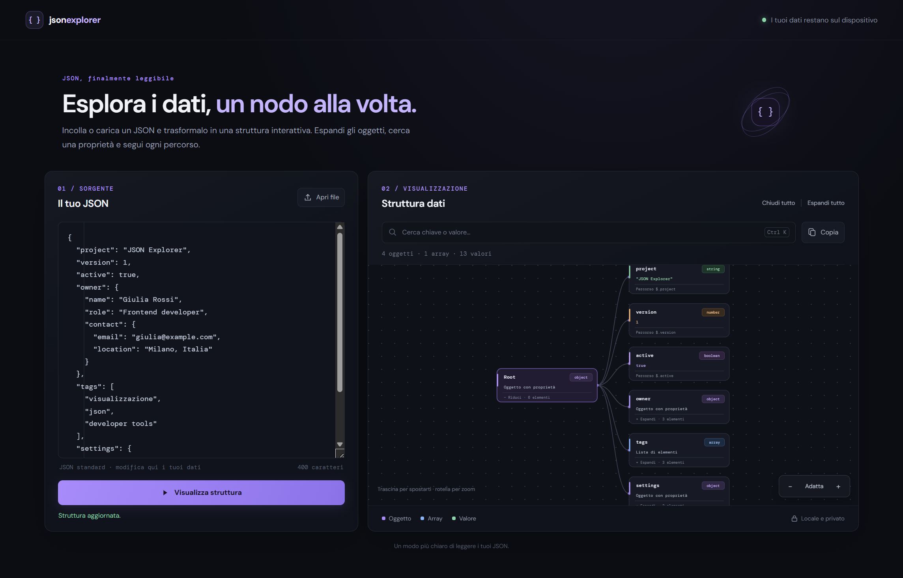
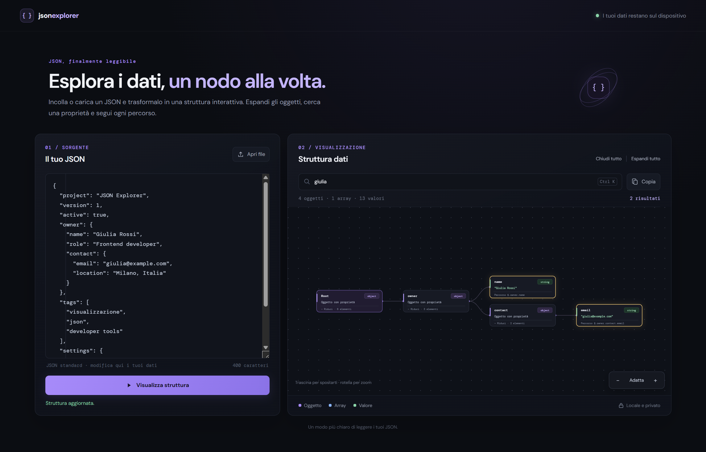

# JSON Explorer

**View and explore your JSON as an interactive diagram.**

JSON Explorer turns objects, arrays, and values into connected cards. Expand
branches, follow relationships, and search your data without getting lost in
brackets. Available as a **Windows desktop app** and a **web app**.

[Download and try releases](https://github.com/seriousjoker-pro/JSON-viewer/releases)
| [Controls guide](#exploring-json)
| [MIT License](LICENSE)

## What's new in version 1.2.0

- Italian and English interface, selectable from the language menu at the top.
- Language selection is remembered between sessions when local storage is available.
- Translated diagram labels, controls, status messages, and errors.
- English documentation and a rebuilt Windows installer containing the localised interface.

## What's new in version 1.1.0

**Improvements**

- Full-screen visualization panel with search and controls still available; exit
  using the button or Esc.
- Diagram-to-editor navigation: clicking a card selects the exact value and
  scrolls its line into view, including when values repeat or keys contain
  special characters.
- Code selection is available in full screen too: when you exit, the last
  selected line is shown in the editor.
- Expanding and collapsing branches centers the selected card while preserving
  the current zoom.

**Fixes**

- Expanding or collapsing a branch no longer resets the zoom to the entire graph.
- Dragging the canvas no longer selects card text; text selection remains
  available in the editor and search field.
- If the JSON has changed since the diagram was generated, you are asked to
  update it instead of selecting a line that may no longer be valid.
- The diagram resizes when the space available in the panel changes.

## Preview



The editor on the left contains the document; the canvas on the right shows its
structure. Objects, arrays, and values have distinct colors, and each card
shows the type and a preview of its contents.

## Windows desktop: download and installation

**Preview release:** the installer build has been verified, but a full
installation and file association on Windows still require manual testing.

You do not need to install Node.js to use the distributed desktop version.

1. Open the [Releases](https://github.com/seriousjoker-pro/JSON-viewer/releases) page.
2. Under **Assets**, download the **1.2.0** installer (`JSON Explorer Setup 1.2.0.exe`;
   GitHub may display its name with periods instead of spaces).
3. Run the installer and choose an installation folder.
4. Launch **JSON Explorer** and use **Open file** to load a `.json` document.

The current installer is for Windows x64. It is not signed with a code-signing
certificate, so Windows may display an unknown publisher warning.

### Updating an existing installation

1. Before closing the app, use **Copy** to retrieve any JSON edits; they are not
   saved automatically.
2. Close JSON Explorer.
3. Download the new installer from the
   [Releases](https://github.com/seriousjoker-pro/JSON-viewer/releases) page.
4. Run it using the same Windows account and keep the same installation folder.
   You do not need to uninstall the previous version first.
5. Reopen the app and check that the **Italiano / English** language selector is available.

There is no automatic updater, so each new version must be installed manually.
Original `.json` documents are not modified. If Windows does not retain the app
as the default, select it again in Settings. Updating over a previous version
still requires manual testing on a user's PC.

### Using "Open with" and setting the default app

The installation registers support for the `.json` extension. In File Explorer,
right-click a document and choose **Open with**, then select **JSON Explorer**.
If it is not listed, choose **Choose another app** and locate `JSON Explorer.exe`
in the installation folder.

To always open JSON files with the app, select JSON Explorer for the `.json`
extension under **Settings > Apps > Default apps**. You must confirm this change;
the installer does not force the default association.

If the app is already open, the file is loaded in the same window, replacing the
currently displayed document. You can read and edit the text in the editor, but
**changes are not saved to the original file**. Use **Copy** to retrieve the
formatted JSON.

## Exploring JSON

1. Paste the document into the editor or use **Open file**.
2. Click **View structure** after each manual edit; loaded files are displayed
   automatically.
3. Click an object or array card to expand or collapse that branch.
4. Search for a key, value, or path; matching results are highlighted and the
   necessary branches are opened.



| Control | Function |
| --- | --- |
| Click a non-empty object or array | Expand or collapse that branch |
| Click a card | Selects the value in the JSON on the left and scrolls its line into view, including when exiting full screen; if the text has changed, update the structure first |
| Enter or Space on a card focused with Tab | Expand or collapse the branch using the keyboard |
| Drag the background | Pan the diagram |
| Mouse wheel or `+` and `-` | Zoom in or out |
| **Fit** | Recenter the diagram and fit its width to the canvas |
| **Full screen** | Show only the visualization panel, with search and controls; press Esc or **Exit full screen** to return to the normal view |
| **Expand all** / **Collapse all** | Expand or collapse every branch |
| **Ctrl+K** or **Cmd+K** | Focus the search field |
| **Copy** | Copy the editor contents as formatted JSON |

Expanding or collapsing a branch centers the selected card in the panel while
preserving the current zoom. **Expand all** and **Collapse all** keep the root as
the reference point. Use **Fit** to explicitly recenter the view. Dragging the
canvas does not select card text; text selection remains available in the
search field and editor.

Documents with a root array or a single root value are also supported, as are
empty objects and arrays, booleans, and `null`. Invalid JSON produces an error
message; line and column are shown when available from the parser.

## Browser version

Open `index.html` in a modern browser. No build step or dependencies are
required to use the viewer.

Use the selector at the top to switch the interface between Italian and English;
your choice is remembered in the browser.

The **Open file** button lets you select a local document. The browser version
does not register Windows file associations; install the desktop version to use
**Open with**.

The **Full screen** button uses native full-screen mode when available. In
contexts that do not support it, the panel fills the page instead.

Clipboard access depends on browser permissions and security context. If it does
not work when opening `index.html` directly, you can serve the folder on
localhost, for example with Python:

```powershell
python -m http.server 8765 --bind 127.0.0.1
```

Then open <http://127.0.0.1:8765>.

## Development and building the installer

To run the desktop version from source, you need Node.js and npm. Run these
commands from the project folder:

```powershell
npm ci
npm start
```

To check JavaScript syntax:

```powershell
npm run check
```

To build the installer on Windows:

```powershell
npm run dist:win
```

Build outputs are written to `dist`:

| Path | Contents |
| --- | --- |
| `dist\JSON Explorer Setup 1.2.0.exe` | Windows installer |
| `dist\win-unpacked\JSON Explorer.exe` | Desktop app executable that can run without installation; keep all files in the same folder |

`dist` and `node_modules` are excluded from Git. The desktop source is included
in the repository. A copy of the installer and a source ZIP are included in
[`installers`](installers) through **Git LFS**, because the executable exceeds
the normal Git file-size limit. You can download them without Git LFS from the
[GitHub Releases](https://github.com/seriousjoker-pro/JSON-viewer/releases)
assets.

If you clone the repository, install [Git LFS](https://git-lfs.com/) and
download the binary files:

```powershell
git lfs install
git lfs pull
```

The source ZIP does not include `node_modules`: after extracting it, run
`npm ci` and `npm start`, or `npm run dist:win` to rebuild the installer. The
`.exe` installer already includes everything needed to run the app and does not
require Node.js.

### Code structure

| File or folder | Responsibility |
| --- | --- |
| `index.html` | Interface shared by the browser and desktop versions |
| `styles.css` | Theme, layout, and diagram styling |
| `app.js` | Parsing, SVG nodes, search, zoom, and interactions |
| `desktop/main.cjs` | Electron window and opening files passed by the system |
| `desktop/preload.cjs` | Isolated communication between Electron and the interface |
| `package.json` | npm scripts, dependencies, and installer / `.json` association configuration |
| `docs/images` | App screenshots used in this guide |
| `installers` | Windows installer and source archive tracked with Git LFS |

## Manual testing of the desktop version

Before using the app as your default viewer, verify these steps on your machine:

- Install and launch the app, then open a JSON file with **Open file**.
- Open a `.json` file using **Open with** while the app is closed, then while it
  is already open.
- Expand and collapse individual branches; try search, zoom, and panning.
- Load invalid JSON and check that the error is reported.
- Try uninstalling and check that your documents remain intact.

## Privacy and current limitations

JSON contents are read and parsed locally on your device; they are not uploaded
to a server. The stylesheet fetches fonts from Google Fonts; system fonts are
used when offline.

The diagram does not yet use virtualization, so very large or deeply nested
documents may slow down rendering. Saving to files, synchronization, and
automatic recovery of edits when closing the app are not supported.

## License

Copyright (c) 2026 Marco Paleari.

Distributed under the [MIT License](LICENSE): use, modification, and
redistribution, including commercial use, are permitted provided the copyright
notice and license are retained. The software is provided without warranties.
