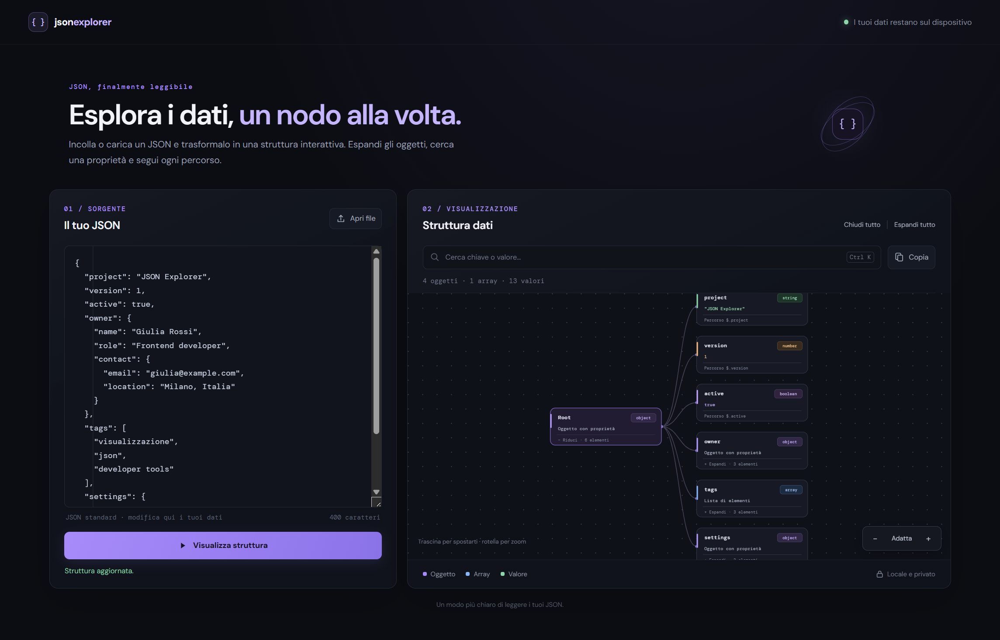
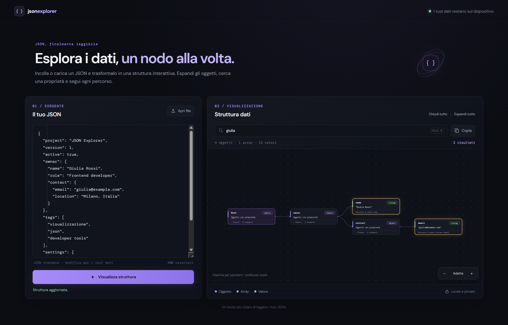

# JSON Explorer

**Visualizza ed esplora i tuoi JSON come un diagramma interattivo.**

JSON Explorer trasforma oggetti, array e valori in schede collegate: puoi aprire
i singoli rami, seguire le relazioni e cercare nei dati senza perderti tra le
parentesi. Disponibile come applicazione **desktop Windows** e come **web app**.

[Download e versioni di prova](https://github.com/seriousjoker-pro/JSON-viewer/releases)
| [Guida ai controlli](#esplorare-un-json)
| [Licenza MIT](LICENSE)

## Novita' della versione 1.1.0

**Migliorie**

- Pannello di visualizzazione a schermo intero, con ricerca e controlli ancora
  disponibili; uscita tramite pulsante o Esc.
- Collegamento fra diagramma ed editor: un clic su una scheda seleziona il valore
  esatto e porta la relativa riga in vista, anche con valori ripetuti o chiavi
  contenenti caratteri speciali.
- Selezione del codice anche a schermo intero: all'uscita viene mostrata
  nell'editor l'ultima riga scelta.
- Apertura e chiusura dei rami con centratura sulla scheda selezionata,
  mantenendo lo zoom corrente.

**Correzioni**

- Il cambio di stato di un ramo non reimposta piu' lo zoom sull'intero grafo.
- Il trascinamento del canvas non seleziona piu' il testo delle schede;
  editor e campo di ricerca conservano la selezione del testo.
- Se il JSON e' stato modificato dopo la generazione del diagramma, viene
  richiesto di aggiornarlo anziche' selezionare una posizione non piu' valida.
- Il diagramma si ridimensiona quando cambia lo spazio disponibile nel pannello.

## Anteprima



L'editor a sinistra contiene il documento; il canvas a destra ne mostra la
struttura. Oggetti, array e valori hanno colori distinti, con tipo e anteprima
del contenuto su ogni scheda.

## Desktop Windows: download e installazione

**Versione di prova:** la build dell'installer e' stata verificata, ma
l'installazione completa e l'associazione dei file su Windows richiedono ancora
una prova manuale.

Non serve installare Node.js per utilizzare la versione desktop distribuita.

1. Apri la pagina [Release](https://github.com/seriousjoker-pro/JSON-viewer/releases).
2. Nella sezione **Assets**, scarica l'installer **1.1.0** (`JSON Explorer Setup 1.1.0.exe`;
   GitHub puo' visualizzarne il nome con punti al posto degli spazi).
3. Esegui l'installer e scegli la cartella di installazione.
4. Avvia **JSON Explorer** e usa **Apri file** per caricare un documento `.json`.

L'installer attuale e' per Windows x64. Non dispone di un certificato di firma
digitale dell'autore: Windows potrebbe mostrare un avviso relativo a un autore
sconosciuto.

### Aggiornare una versione gia' installata

1. Prima di chiudere l'app, recupera con **Copia** eventuali modifiche al JSON:
   non vengono salvate automaticamente.
2. Chiudi JSON Explorer.
3. Scarica il nuovo installer dalla pagina
   [Release](https://github.com/seriousjoker-pro/JSON-viewer/releases).
4. Eseguilo con lo stesso account Windows e mantieni la stessa cartella
   d'installazione usata in precedenza. Non serve disinstallare prima.
5. Riapri l'app e verifica la presenza del pulsante **Schermo intero**.

Non e' presente un aggiornamento automatico: ogni nuova versione va installata
manualmente. I documenti `.json` originali non vengono modificati. Se Windows
non mantiene l'app predefinita, selezionala nuovamente nelle impostazioni.
L'aggiornamento sopra la versione precedente richiede ancora una verifica
manuale sul PC dell'utente.

### Usare "Apri con" e impostare l'app predefinita

L'installazione registra il supporto per l'estensione `.json`.
Da Esplora file, fai clic destro su un documento e scegli **Apri con**,
quindi seleziona **JSON Explorer**. Se non compare, usa **Scegli un'altra app**
e individua `JSON Explorer.exe` nella cartella di installazione.

Per aprire sempre i JSON con l'app, scegli JSON Explorer per l'estensione `.json`
in **Impostazioni > App > App predefinite**. La modifica va confermata da te:
l'installer non forza l'associazione predefinita.

Se l'app e' gia' aperta, il file viene caricato nella stessa finestra, sostituendo
il documento visualizzato. L'app permette di leggere e modificare il testo
nell'editor, ma **non salva le modifiche sul file originale**: usa **Copia**
per recuperare il JSON formattato.

## Esplorare un JSON

1. Incolla il documento nell'editor oppure usa **Apri file**.
2. Premi **Visualizza struttura** dopo ogni modifica manuale; un file caricato
   viene visualizzato automaticamente.
3. Fai clic su una scheda oggetto o array per aprire o chiudere quel ramo.
4. Cerca una chiave, un valore o un percorso: i risultati vengono evidenziati
   e i rami necessari vengono aperti.



| Controllo | Funzione |
| --- | --- |
| Clic su un oggetto o array non vuoto | Espande o riduce il singolo ramo |
| Clic su una scheda | Seleziona il valore nel JSON a sinistra e porta la riga in vista, anche all'uscita dallo schermo intero; se il testo e' stato modificato, occorre prima aggiornare la struttura |
| Invio o Spazio su una scheda selezionata con Tab | Espande o riduce il ramo da tastiera |
| Trascinamento dello sfondo | Sposta il diagramma |
| Rotella del mouse oppure `+` e `-` | Aumenta o riduce lo zoom |
| **Adatta** | Ricentra il diagramma e adatta la larghezza al canvas |
| **Schermo intero** | Mostra solo il pannello di visualizzazione, con ricerca e controlli; premi Esc o **Esci da schermo intero** per tornare alla vista normale |
| **Espandi tutto** / **Chiudi tutto** | Apre o chiude tutti i rami |
| **Ctrl+K** oppure **Cmd+K** | Porta il cursore nella ricerca |
| **Copia** | Copia il contenuto dell'editor come JSON formattato |

Aprire o chiudere un ramo centra la scheda selezionata nel pannello, mantenendo
lo zoom corrente. I comandi **Espandi tutto** e **Chiudi tutto** mantengono
come riferimento la radice. Usa **Adatta** per ricentrare esplicitamente la vista.
Il trascinamento sul canvas non seleziona il testo delle schede; la selezione
nei campi di ricerca e nell'editor rimane disponibile.

Sono supportati anche documenti con una radice array o un valore singolo,
oggetti e array vuoti, booleani e `null`. Un JSON non valido produce un messaggio
d'errore; riga e colonna vengono mostrate quando disponibili dal parser.

## Versione browser

Apri `index.html` in un browser moderno: non sono richieste compilazione o
dipendenze per usare il visualizzatore.

Il pulsante **Apri file** consente di selezionare un documento locale. La versione
browser non registra associazioni Windows: per usare **Apri con** installa la
versione desktop.

Il pulsante **Schermo intero** usa la modalita' nativa quando disponibile;
nei contesti che non la supportano, il pannello occupa l'intera area della pagina.

La copia negli appunti dipende dai permessi e dal contesto di sicurezza del
browser. Se non funziona aprendo direttamente `index.html`, puoi servire la
cartella su localhost, ad esempio con Python:

```powershell
python -m http.server 8765 --bind 127.0.0.1
```

Poi apri <http://127.0.0.1:8765>.

## Sviluppo e creazione dell'installer

Per avviare la versione desktop dal codice sorgente servono Node.js e npm.
Esegui questi comandi dalla cartella del progetto:

```powershell
npm ci
npm start
```

Per controllare la sintassi JavaScript:

```powershell
npm run check
```

Per generare l'installer su Windows:

```powershell
npm run dist:win
```

I risultati vengono scritti in `dist`:

| Percorso | Contenuto |
| --- | --- |
| `dist\JSON Explorer Setup 1.1.0.exe` | Installer Windows |
| `dist\win-unpacked\JSON Explorer.exe` | Applicazione desktop eseguibile senza installazione, da mantenere con tutti i file della stessa cartella |

`dist` e `node_modules` sono esclusi da Git. Il sorgente desktop e' incluso
nel repository. Una copia dell'installer e lo ZIP dei sorgenti sono inclusi in
[`installers`](installers) tramite **Git LFS**, perche' l'eseguibile supera il
limite dei normali file Git. Per scaricarli senza Git LFS puoi usare gli allegati
delle [Release GitHub](https://github.com/seriousjoker-pro/JSON-viewer/releases).

Se cloni il repository, installa [Git LFS](https://git-lfs.com/) e scarica i
file binari:

```powershell
git lfs install
git lfs pull
```

Lo ZIP dei sorgenti non contiene `node_modules`: dopo averlo estratto, usa
`npm ci` e `npm start`, oppure `npm run dist:win` per ricreare l'installer.
L'installer `.exe`, invece, contiene il necessario per eseguire l'app e non
richiede Node.js.

### Struttura del codice

| File o cartella | Responsabilita' |
| --- | --- |
| `index.html` | Interfaccia condivisa da browser e desktop |
| `styles.css` | Tema, layout e stile del diagramma |
| `app.js` | Parsing, nodi SVG, ricerca, zoom e interazioni |
| `desktop/main.cjs` | Finestra Electron e apertura dei file passati dal sistema |
| `desktop/preload.cjs` | Comunicazione isolata fra Electron e interfaccia |
| `package.json` | Comandi npm, dipendenze e configurazione installer/associazione `.json` |
| `docs/images` | Schermate dell'app utilizzate in questa guida |
| `installers` | Installer Windows e archivio dei sorgenti tracciati con Git LFS |

## Verifica manuale della versione desktop

Prima di utilizzare l'app come visualizzatore predefinito, verifica questi
passaggi sulla tua macchina:

- Installa l'app, avviala e apri un JSON con **Apri file**.
- Apri un `.json` da **Apri con** a programma chiuso e poi gia' aperto.
- Espandi e richiudi i singoli rami; prova ricerca, zoom e trascinamento.
- Carica un JSON non valido e verifica che venga segnalato l'errore.
- Prova la disinstallazione e controlla che i tuoi documenti siano rimasti intatti.

## Privacy e limiti attuali

Il contenuto dei JSON viene letto e analizzato localmente sul dispositivo:
non viene caricato su un server. Il foglio di stile richiede i font a Google
Fonts; senza connessione vengono usati i font di sistema.

Il diagramma non usa ancora la virtualizzazione: documenti molto grandi o
profondamente annidati possono rallentare il rendering. Non sono previsti
salvataggio su file, sincronizzazione o ripristino automatico delle modifiche
alla chiusura dell'app.

## Licenza

Copyright (c) 2026 Marco Paleari.

Distribuito con [licenza MIT](LICENSE): sono consentiti uso, modifica e
ridistribuzione, anche commerciale, mantenendo l'avviso di copyright e la
licenza. Il software viene fornito senza garanzie.
